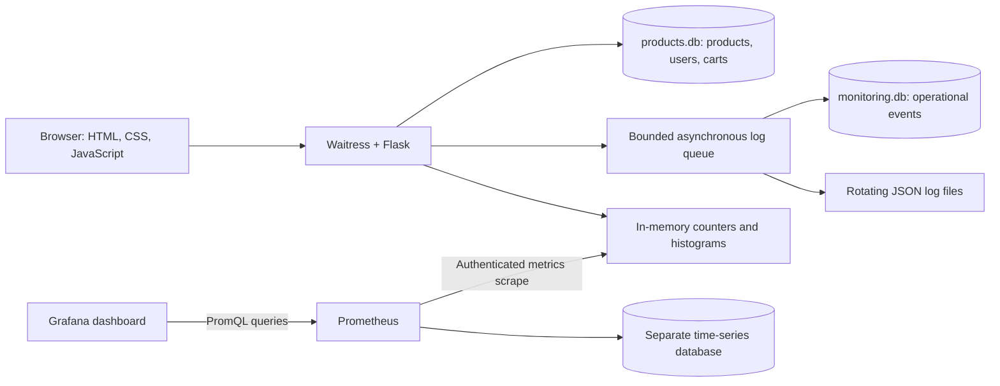

# Architecture and important decisions

## Component flow

This is the original Part 1 catalog extended in place. The existing product records,
images and pages remain; Part 2 adds authentication/carts and Part 3 adds instrumentation.
The frontend uses plain JavaScript and reusable HTML templates. Flask handles pages,
JSON APIs and authorization. Waitress serves the application in one process with eight
threads so the in-memory metric registry is shared consistently.

## Authentication and authorization

- Registration stores a display name, unique case-insensitive username, and salted
  scrypt hash. Passwords are verified with Werkzeug, never compared as plaintext.
- Flask-Login maintains identity in a signed Flask session cookie. The cookie contains
  session data, not passwords or cart contents. It is HttpOnly and SameSite=Lax, with
  an eight-hour lifetime from login. The persistent signing key permits server restarts.
- Logout clears the browser session; cart contents remain in SQLite.
- Flask-WTF validates CSRF tokens for registration, login, logout and cart mutations.
- Protected page requests redirect to login, preserving a validated local return URL.
  Protected API requests return JSON 401 rather than login-page HTML.
- Cart ownership comes from the authenticated identity. Explicit cart-ID requests use
  both `cart.id` and `cart.user_id` in the backend query. Another user's cart returns
  404; changing the URL, query string or body cannot select a different owner.
- SQL uses bound parameters. Jinja escaping and JavaScript `textContent` prevent
  interpreting database/user text as markup.

## Cart behavior

Each registered user has one persistent cart. The first Add to cart action stores
quantity 1. Catalog cards show quantity controls and move cart items to the top.
Quantity edits save automatically; the cart page updates subtotals and total after
receiving the authoritative server response. Typing is briefly debounced and writes
are serialized to prevent older responses from overwriting newer state.

Quantities must be integers from 1 to 99 and cannot exceed stock. Setting the UI to
zero issues a DELETE request. Backend mutations run in a SQLite transaction, with
`BEGIN IMMEDIATE` protecting read-modify-write additions. Stock validation is repeated
on the server; disabled buttons are only a convenience.

Prices are integer paise, avoiding floating-point currency arithmetic. Cart totals
use the current product prices fetched from SQLite. Requests supplying their own price
or owner fields are rejected. Adding to cart does not reserve stock; checkout, payment,
orders and stock deduction are outside this assignment implementation.

## Schema evolution

Alembic tracks applied revisions in `alembic_version`. Startup upgrades to the current
revision, and the CLI offers explicit setup/history commands. Existing Part 1 tables
are adopted without reseeding; fresh installs receive a frozen 20-product seed.
Existing users and carts created before Alembic are also preserved. SQLite migrations
and their revision markers run transactionally. Destructive downgrades are disabled;
restore a backup when a rollback is needed.

## Monitoring isolation and privacy

Instrumentation does not add monitoring tables or queries to the shop database.
Prometheus scrapes in-memory counters/histograms. A background listener writes
allowlisted events to a different SQLite database and rotating JSON files. Grafana
has its own settings database and queries Prometheus, not products.db.

Every request receives a server-generated request ID, returned as `X-Request-ID` and
used in correlated log events. Logs record timestamps, severity, endpoint names,
status and duration. Database and unexpected exceptions record their type and
stack-frame locations; messages, SQL, local variables and source text are excluded.
Passwords, hashes, authentication/CSRF tokens, cookies, usernames, IP addresses,
request bodies, raw paths and query strings are not logged.

Metric labels use bounded method/endpoint/status values. They do not include user IDs,
product IDs or request IDs, which would create excessive time series. The log queue
is bounded and non-blocking; overflow/storage failures have their own metrics.
There is still small CPU/memory overhead, but no telemetry SQL load on products.db.

## Operational choices and scope

- All services bind to localhost for the single-computer demonstration.
- Prometheus scrapes every five seconds, authenticated with a separate bearer token.
- Grafana's datasource and 12-panel dashboard are provisioned from version-controlled
  files. Charts use rates/increases that handle backend counter resets.
- Normal application startup leaves controlled failures disabled. Demo mode enables
  an authenticated, CSRF-protected endpoint that raises errors without damaging data.
- JSON logs rotate; monitoring SQLite prunes old events; Prometheus retains bounded
  history. These choices limit telemetry storage growth.
- Horizontal scaling/multiple worker processes would require a suitable shared SQL
  service and Prometheus multiprocess configuration. The submitted launcher uses the
  tested single-process setup instead.
