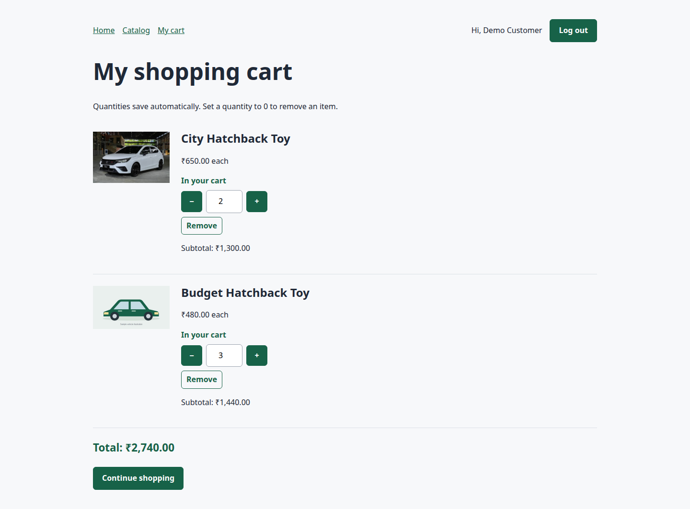
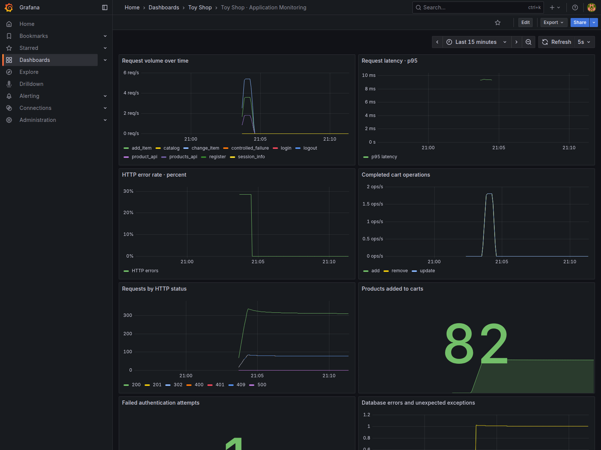

# Legendry Toy Cars — submission guide

A full-stack toy-car shop built by extending the original product catalog with
registration, login, user-owned shopping carts, database migrations, structured
logging and Prometheus/Grafana monitoring.

## Documentation index

| Document | Contents |
| --- | --- |
| [Setup and configuration](SETUP.md) | Prerequisites, fresh-clone setup, all startup commands, credentials and troubleshooting |
| [Architecture and decisions](ARCHITECTURE.md) | Components, authentication, authorization, cart behavior, storage and monitoring design |
| [Database and migrations](DATABASE.md) | Schema definitions, relationships, upgrade commands and preservation tests |
| [Verification and submission checklist](VERIFICATION.md) | Requirement-to-file mapping, tests, traffic/failure demo and files to submit |
| [Screenshots](SCREENSHOTS.md) | Authentication flow, catalog, shopping cart and actual Grafana dashboard |

All commands below and in these documents run from the **repository root**, not from
inside `readme/`. The repository URL is supplied by the person submitting the project.

## Quick start: application and monitoring on one computer

The supplied complete-stack installer supports **Linux x86_64**. Use Python **3.12+
with pip and venv** for the documented full setup, a modern browser, and internet
access for the first installation. The implementation was tested with Python 3.14.
Docker, Node.js and an external SQL server are not required.

After cloning the submitted repository and changing into its root:

```sh
python3 -m venv .venv
.venv/bin/python -m pip install -r requirements.txt
.venv/bin/python -m alembic upgrade head
.venv/bin/python monitoring/install.py
.venv/bin/python monitoring/stack.py --app-port 5001 --demo
```

Keep this terminal open. The final command starts the **existing shop, Prometheus and
Grafana together**. Do not start `app.py` separately when using the stack launcher.

| Component | Address | Access |
| --- | --- | --- |
| Shopping application | http://127.0.0.1:5001/ | Register a new user, then log in |
| Prometheus target status | http://127.0.0.1:9090/targets | `toy-shop` should be UP |
| Grafana dashboard | http://127.0.0.1:3000/d/toy-shop | Credentials generated locally on first startup |

For Grafana, open `monitoring/runtime/credentials.json` locally and use its
`grafana_username` and `grafana_password` fields. This file is generated on the new
computer; there are **no shared/pre-seeded application accounts or Grafana passwords**
in the submission. Do not publish the credentials file.

In a second terminal at the repository root:

```sh
.venv/bin/python monitoring/demo.py --app-url http://127.0.0.1:5001 --seconds 60
.venv/bin/python monitoring/verify_dashboard.py
```

The demo uses a dedicated account, performs real cart operations, generates controlled
errors, and verifies changes in Prometheus. Watch Grafana with **Last 15 minutes**
selected. The verification script checks all 12 dashboard panels through Grafana's
Prometheus datasource.

Press **Ctrl+C in the stack terminal** to stop all three services. Database and
monitoring history remain saved. For normal use, start the stack without `--demo`:

```sh
.venv/bin/python monitoring/stack.py --app-port 5001
```

## What is implemented

- Registration and login using Flask-Login, salted scrypt password hashes, signed
  sessions, logout and CSRF protection.
- Server-enforced access restrictions; unauthenticated page visitors return to their
  requested page after login. Another user's cart cannot be accessed by changing IDs.
- SQL-persisted carts with server-sourced prices and backend stock/quantity checks.
- Catalog quantity controls with cart items first; automatic cart totals after saves.
- Alembic revisions for both fresh installation and upgrading the Part 1 database.
- Structured JSON logging, a separate operational-events database, HTTP/application
  metrics, Prometheus collection, and an automatically provisioned Grafana dashboard.
- Repeatable authorization, migration, monitoring and controlled-failure demonstrations.

## Source and configuration locations

| Required artifact | Repository location |
| --- | --- |
| Frontend | [index.html](../index.html), [products/](../products/), [cart.html](../cart.html), [script.js](../script.js), [style.css](../style.css) |
| Authentication templates | [templates/auth.html](../templates/auth.html) |
| Backend | [app.py](../app.py), [observability.py](../observability.py), [db_migrations.py](../db_migrations.py) |
| Python dependencies | [requirements.txt](../requirements.txt) |
| Reference SQL schema | [schema.sql](../schema.sql) |
| Versioned migrations | [migrations/versions/](../migrations/versions/), [alembic.ini](../alembic.ini), [migrations/env.py](../migrations/env.py) |
| Fresh database seed | [migrations/data/part1_products.sql](../migrations/data/part1_products.sql) |
| Application/stack configuration | [app.py](../app.py), [monitoring/stack.py](../monitoring/stack.py), [SETUP.md](SETUP.md) |
| Prometheus configuration | [monitoring/prometheus.yml](../monitoring/prometheus.yml) |
| Grafana datasource/provider | [monitoring/grafana/provisioning/](../monitoring/grafana/provisioning/) |
| Grafana dashboard export | [monitoring/grafana/dashboards/toy-shop.json](../monitoring/grafana/dashboards/toy-shop.json) |
| Tests | [tests/](../tests/) |
| Submission screenshots | [readme/screenshots/](screenshots/) |

Configuration and SQL remain in their original working locations; this folder links
to them rather than keeping duplicate copies that could become inconsistent.

## Screenshots included in this folder





See [SCREENSHOTS.md](SCREENSHOTS.md) for the complete authentication flow and captions.
