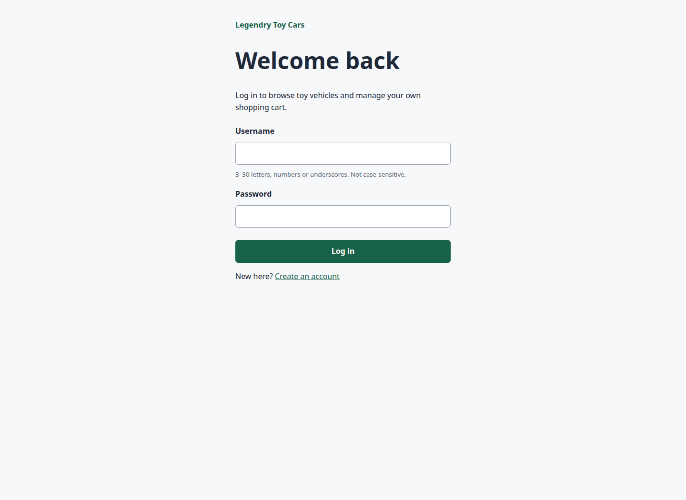
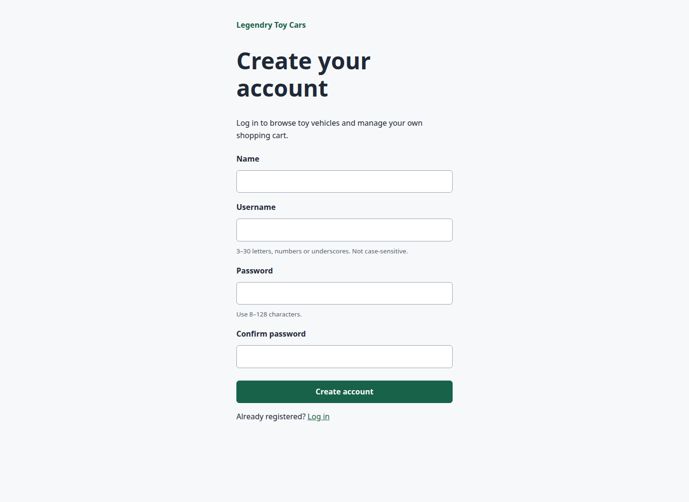
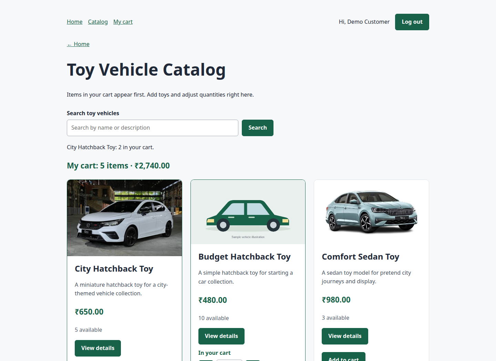
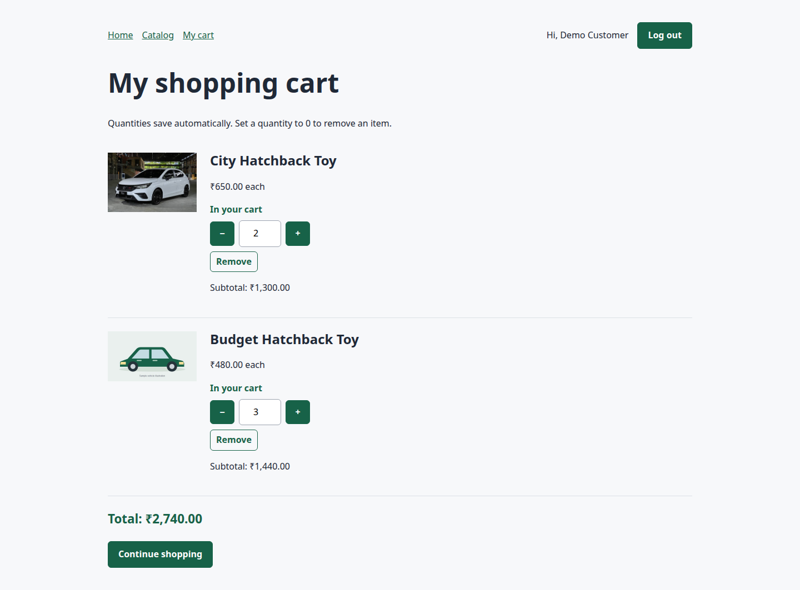
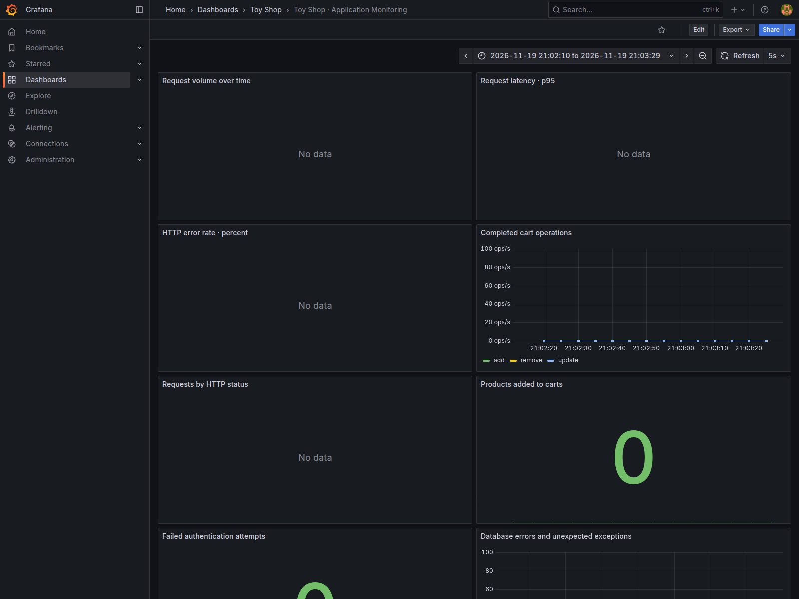
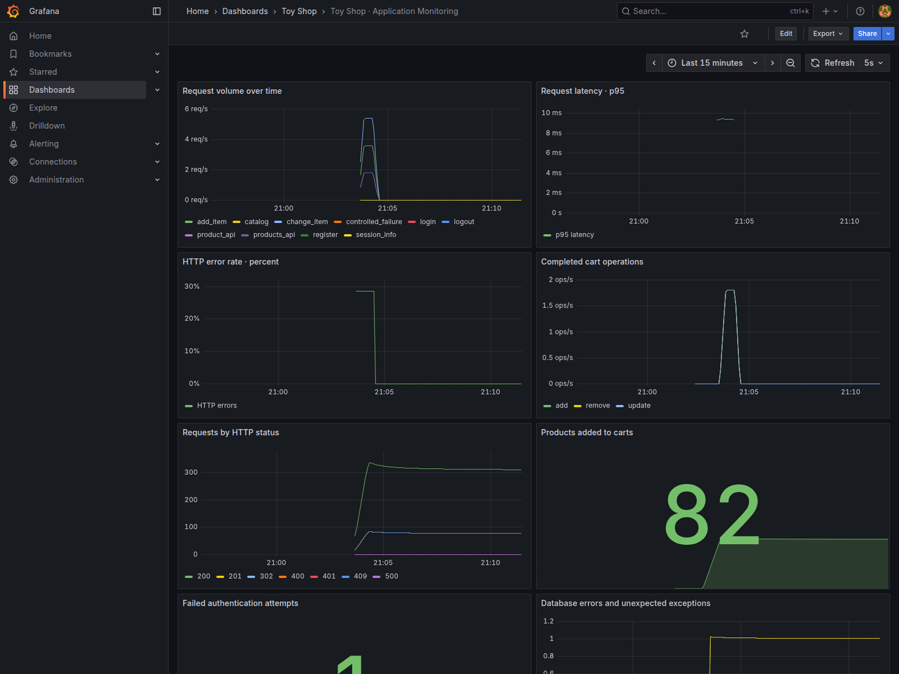

# Screenshot evidence

These are actual application and Grafana browser captures, not mockups. Authentication and shopping screenshots were captured with a disposable database and fictitious demo account, without changing existing users' carts. Grafana captures show the recorded live monitoring demonstration. All images are included in this folder and do not depend on ignored runtime files.

## 1. Authentication required

Opening the cart while logged out redirects to login, retaining the intended destination.

## 2. Registration

Registration collects name, username and password. Password hashing occurs on the backend; the password is not shown in this screenshot.

## 3. Catalog quantity controls

Products already in the cart appear first. Quantities can be changed directly in the catalog.

## 4. Persistent shopping cart

The demo cart contains two City Hatchback Toys and three Budget Hatchback Toys, totaling ₹2,740. Quantity and removal controls save through the backend; the total updates automatically after a successful change.

## 5. Grafana after traffic

Real Prometheus samples show HTTP volume, latency, error rates and cart operations after interacting with the application and running the traffic demo.

## 6. Grafana before traffic

This capture uses the retained historical window before the same demonstration. Compare its request and cart-operation activity with the preceding dashboard capture.

## 7. Failure monitoring

The failure panels show failed authentication and controlled application/database exceptions. Controlled failures generate telemetry without damaging application data.

For a new demonstration, follow [VERIFICATION](VERIFICATION.md). For new screenshots, use the browser's screenshot facility after repeating these flows; avoid capturing filled passwords or the local credentials file.
